# Nepali-RAG

Retrieval Augmented Generation framework purpose-built for the Nepali language documents, articles, books etc.

Plugable into any chatbot, search interface, or LLM wrapper to give your application grounded, citation-backed answers from Nepali documents. Supports **LLM tool-calling**, the model autonomously decides when document retrieval is needed..

**Why this exists:** Most RAG tooling assumes Latin-script languages. Nepali RAG handles the specific challenges of Devanagari text end-to-end.

## Contents

1. [Prerequisites](#1-prerequisites)
2. [Installation](#2-installation)
3. [Quick Start](#3-quick-start)
   - [3.1 Ingest a document](#31-ingest-a-document)
   - [3.2 Query your documents](#32-query-your-documents)
   - [3.3 Start the FastAPI server](#33-start-the-fastapi-server)
4. [Configuration](#4-configuration)
5. [CLI Reference](#5-cli-reference)
6. [Supported Document Formats](#6-supported-document-formats)
7. [LLM Providers](#7-llm-providers)
8. [FastAPI Server Configuration](#8-fastapi-server-configuration)
9. [Project Structure](#9-project-structure)
10. [Component Details](#10-component-details)
    - [i. Architecture](#i-architecture)
    - [ii. Document Ingestion](#ii-document-ingestion-nepali_ragingestion)
    - [iii. Text Preprocessing](#iii-text-preprocessing-nepali_ragpreprocessing)
    - [iv. Chunking](#iv-chunking-nepali_ragchunking)
    - [v. Embeddings](#v-embeddings-nepali_ragembeddings)
    - [vi. Vector Store](#vi-vector-store-nepali_ragvectorstore)
    - [vii. Retrieval](#vii-retrieval-nepali_ragretrieval)
    - [viii. RAG Chain](#viii-rag-chain-nepali_ragrag)
    - [ix. Tool-Calling Mode](#ix-tool-calling-mode)
    - [x. LLM Integration](#x-llm-integration-nepali_ragllm)
    - [xi. Document Pipeline](#xi-document-pipeline-nepali_ragpipeline)
    - [xii. FastAPI Server](#xii-fastapi-server-nepali_ragapi)
    - [xiii. RAG Configuration](#xiii-rag-configuration-nepali_ragconfig)
11. [License](#11-license)

## 1. Prerequisites

- **Python 3.10+**
- **Tesseract OCR** with Nepali language data (`nep` trained data)
  - Linux: `sudo apt install tesseract-ocr tesseract-ocr-nep`
  - macOS: `brew install tesseract` then download `nep.traineddata`
  - Windows: install from [UB Mannheim builds](https://github.com/UB-Mannheim/tesseract/wiki) and add Nepali language data from [here](https://github.com/tesseract-ocr/tessdata/blob/main/nep.traineddata)
- **Qdrant** vector database instance (cloud)
  - Create a cluster at [cloud.qdrant.io](https://cloud.qdrant.io) - you'll need the URL and API key
- **LLM backend** (at least one):
  - Ollama (easiest): `ollama pull gemma4` or any other model of choice (would recommend a model that supports tool-calling)
  - vLLM server for OpenAI-compatible API
  - OpenAI API key
  - Any OpenAI-compatible provider (Groq, DeepSeek, Together AI, Fireworks, Mistral, etc.) - just needs an API key and base URL
  - Google Gemini API key
  - Hugging-face API key

## 2. Installation

```bash
git clone https://github.com/Swastik-Aryal/Nepali-RAG.git
cd Nepali-RAG
pip install -e . --config-settings editable_mode=compat
```

This installs all dependencies (document parsers, embeddings, vector store, LLM providers, API server).

**GPU acceleration (recommended):** The default install pulls the CPU-only PyTorch build from PyPI. If you have an NVIDIA GPU, install the CUDA version of PyTorch **before or after** running `pip install -e .`:

```bash
# Example for CUDA 12.1 (check your version with: nvidia-smi)
pip install torch --index-url https://download.pytorch.org/whl/cu121
```

### Environment File (Optional but Recommended)

For the Python usage (less control snippets), the library reads settings from a `.env` file. Copy the template:

```bash
cp .env.example .env
```

> **Important:** For Python scripts, the `.env` file is loaded from your **current working directory** (CWD). For the API server, you can point to any `.env` file with `nepali-rag serve --env-file /path/to/.env`.

At minimum, set your Qdrant connection:

```env
QDRANT_URL=https://your-cluster.cloud.qdrant.io
QDRANT_API_KEY=your-qdrant-api-key
```

> **Note:** If `.env` file is absent, the library will use the default values set in the [config/settings.py](./nepali_rag/config/settings.py) (can also be viewed in `env.example`) file.

> **Note:** The `.env` file is **not required** for terminal (CLI) usage. All parameters are passed directly as command-line arguments.

## 3. Quick Start

### 3.1 Ingest a document

**Python (less control, requires `.env` file):**

```python
from nepali_rag import DocumentPipeline

pipeline = DocumentPipeline()
result = pipeline.ingest("path/to/document.pdf")
print(result)
# {'collection_name': 'doc_a1b2c3d4e5f6', 'filename': '...', 'pages_extracted': 12, 'chunks_created': 45, 'chunks_indexed': 45}
```

**Python (more control, no `.env` needed, all params in code):**

```python
from nepali_rag import DocumentPipeline, NepaliEmbeddingModel, QdrantStore

embedding_model = NepaliEmbeddingModel()
store = QdrantStore(  
    collection_name="my_collection",
    url="https://your-cluster.cloud.qdrant.io",
    api_key="your-qdrant-api-key",
)

pipeline = DocumentPipeline(
    embedding_model=embedding_model,
    vector_store=store,
    chunk_size=256,
    chunk_overlap_sentences=2,
)

# Single document
result = pipeline.ingest("path/to/document.pdf")
print(result)
# {'collection_name': 'my_collection', 'filename': '...', 'pages_extracted': 12, 'chunks_created': 45, 'chunks_indexed': 45}

# Multiple documents (batch ingestion into the same collection)
results = pipeline.ingest_batch([
    "path/to/document1.pdf",
    "path/to/document2.pdf",
    "path/to/notes.docx",
])
for r in results:
    print(f"{r['filename']}: {r['chunks_indexed']} chunks indexed")
```

**Terminal (no `.env` needed, all params as arguments):**

```bash
nepali-rag ingest doc1.pdf doc2.pdf notes.docx \
  --qdrant-url https://your-cluster.cloud.qdrant.io \
  --qdrant-api-key your-qdrant-api-key \
  -c my_collection \
  --chunk-size 256 \
  --chunk-overlap 2 \
  -v
```
---
### 3.2 Query your documents

**Python (less control, requires `.env` file):**

```python
from nepali_rag import Retriever, QdrantStore, RAGChain, get_llm

store = QdrantStore(collection_name="my_collection") # Name of collection where chunks are stored (Defaults to .env/settings.py value)
retriever = Retriever(store=store)
llm = get_llm()
chain = RAGChain(retriever=retriever, llm=llm)

result = chain.run(question="नेपालको संविधानमा के लेखिएको छ?")
print(result["answer"])
```

**Python (more control, no `.env` needed, all params in code):**

```python
from nepali_rag import (
    Retriever, Reranker, QdrantStore,
    NepaliEmbeddingModel, RAGChain, get_llm,
)

store = QdrantStore(
  collection_name="my_collection", # Name of collection where chunks are stored (Defaults to .env/settings.py value)
  url="https://your-cluster.cloud.qdrant.io",
  api_key="your-qdrant-api-key"
)

embedding_model = NepaliEmbeddingModel()
reranker = Reranker()

retriever = Retriever(embedding_model=embedding_model, reranker=reranker, store=store)
llm = get_llm(provider="gemini", model="gemini-2.5-flash", api_key="your-google-api-key") # api_key not used if provider = "ollama" OR "vllm", set base_url in that case 
chain = RAGChain(retriever=retriever, llm=llm, use_tools=True)

# First question
result = chain.run(question="नेपालको संविधानमा के लेखिएको छ?", top_k_retrieval=20, top_k_rerank=5)
print(result["answer"])

# Follow-up with conversation history (only the current question is used for retrieval)
history = [
    {"role": "user", "content": "नेपालको संविधानमा के लेखिएको छ?"},
    {"role": "assistant", "content": result["answer"]},
]
follow_up = chain.run(
    question="त्यसको बारेमा थप विस्तारमा बताउनुहोस्",
    conversation_history=history,
    top_k_retrieval=20,
    top_k_rerank=5
)
print(follow_up["answer"])
```

**Conversation history format:**

```python
# A list of previous turns (do NOT include the current question here)
conversation_history = [
    {"role": "user", "content": "नेपालको राजधानी कहाँ हो?"},
    {"role": "assistant", "content": "नेपालको राजधानी काठमाडौं हो।"},
    {"role": "user", "content": "त्यहाँको जनसंख्या कति हो?"},
    {"role": "assistant", "content": "काठमाडौं उपत्यकाको जनसंख्या लगभग ३० लाख छ।"},
]
```

**Terminal (no `.env` needed, all params as arguments):**

```bash
nepali-rag query "नेपालको संविधानमा के लेखिएको छ?" \
  --qdrant-url https://your-cluster.cloud.qdrant.io \
  --qdrant-api-key your-qdrant-api-key \
  -c my_collection \
  --provider ollama \
  --model gemma4 \
  --top-k 20 \
  --top-r 5 \
  --temperature 0.3 \
  -v
```

With conversation history (pass a JSON file or inline JSON):

```bash
# Using a JSON file
nepali-rag query "त्यसको बारेमा थप विस्तारमा बताउनुहोस्" \
  --qdrant-url https://your-cluster.cloud.qdrant.io \
  --qdrant-api-key your-qdrant-api-key \
  -c my_collection \
  --provider ollama \
  --model gemma4 \
  --history history.json \
  -v

# Using inline JSON
nepali-rag query "Can you translate that to English?" \
  --qdrant-url https://your-cluster.cloud.qdrant.io \
  --qdrant-api-key your-qdrant-api-key \
  -c my_collection \
  --provider ollama \
  --model gemma4 \
  --history '[{"role":"user","content":"नेपालको राजधानी कहाँ हो?"},{"role":"assistant","content":"नेपालको राजधानी काठमाडौं हो।"}]' \
  -v
```

> **Tip:** By default, tool-calling mode is enabled, the LLM decides when retrieval is needed (recommended). Use `--disable-tools` to force retrieval on every query (always-retrieve mode).

For providers that need an API key (openai, gemini, hf):

```bash
nepali-rag query "नेपालको संविधानमा के लेखिएको छ?" \
  --qdrant-url https://your-cluster.cloud.qdrant.io \
  --qdrant-api-key your-qdrant-api-key \
  -c my_collection \
  --provider gemini \
  --model gemini-2.5-flash \
  --api-key your-google-api-key \
  -v
```
---
### 3.3 Start the FastAPI server

**Terminal:**

```bash
# Uses .env from CWD by default
nepali-rag serve --host 0.0.0.0 --port 8080 --reload -v

# Point to a .env file anywhere on disk
nepali-rag serve --env-file /path/to/.env --port 8080 -v
```

The API will be available at `http://localhost:8080`. Interactive docs at `http://localhost:8080/docs`.

> **Note:** The API server reads configuration from a `.env` file (Qdrant credentials, LLM provider, etc.). Use `--env-file` to specify the path if it's not in your current directory.

## 4. Configuration

Default settings in [config/settings.py](./nepali_rag/config/settings.py). Can be overridden/managed through a `.env` file. See [`.env.example`](.env.example) for the full list.

| Setting                     | Default                                        | Purpose                                                               |
| --------------------------- | ---------------------------------------------- | --------------------------------------------------------------------- |
| `QDRANT_URL`              | *(empty)*                                    | Vector database connection URL                                        |
| `QDRANT_API_KEY`          | *(empty)*                                    | Qdrant Cloud authentication key                                       |
| `COLLECTION_NAME`         | `nepali_docs`                                | Default Qdrant collection                                             |
| `EMBEDDING_MODEL`         | `intfloat/multilingual-e5-large`             | Embedding model name                                                  |
| `RERANKER_MODEL`          | `cross-encoder/mmarco-mMiniLMv2-L12-H384-v1` | Reranker model name                                                   |
| `LLM_PROVIDER`            | `ollama`                                     | LLM backend:`vllm`, `openai`, `gemini`, `ollama`, `hf`, `anthropic`      |
| `VLLM_MODEL`              | `google/gemma-4-E4B-it`                      | Model for vLLM provider                                               |
| `VLLM_BASE_URL`           | `http://localhost:8000/v1`                   | vLLM server endpoint                                                  |
| `OPENAI_API_KEY`          | *(empty)*                                    | OpenAI API key (or key for any OpenAI-compatible provider)            |
| `OPENAI_BASE_URL`         | *(empty)*                                    | Custom base URL for OpenAI-compatible providers (e.g. Groq, DeepSeek) |
| `OPENAI_MODEL`            | `gpt-4o-mini`                                | Model for OpenAI / OpenAI-compatible provider                         |
| `GOOGLE_API_KEY`          | *(empty)*                                    | Google API key for Gemini                                             |
| `GEMINI_MODEL`            | `gemini-2.5-flash`                           | Model for Gemini provider                                             |
| `OLLAMA_BASE_URL`         | `http://localhost:11434`                     | Ollama server endpoint                                                |
| `OLLAMA_MODEL`            | `gemma4`                                     | Model for Ollama provider                                             |
| `HF_MODEL_NAME`           | `Qwen/Qwen3.6-35B-A3B`                       | Model for hugging-face-inference-api                                  |
| `HF_BASE_URL`             | `https://router.huggingface.co/v1`           | hugging-face-inference endpoint                                       |
| `HF_TOKEN`                | *(empty)*                                    | Your hugging-face api token                                           |
| `ANTHROPIC_API_KEY`       | *(empty)*                                    | Anthropic API key for Claude                                          |
| `ANTHROPIC_MODEL`         | `claude-opus-4-6`                   | Model for Anthropic provider                                          |
| `TESSERACT_LANGUAGES`     | `nep`                                        | OCR language configuration                                            |
| `CHUNK_SIZE`              | `256`                                        | Maximum chunk size in tokens                                          |
| `CHUNK_OVERLAP_SENTENCES` | `2`                                          | Sentence overlap between chunks                                       |
| `TOP_K_RETRIEVAL`         | `20`                                         | Hybrid search candidate count                                         |
| `TOP_K_RERANK`            | `5`                                          | Final reranked result count                                           |
| `DENSE_WEIGHT`            | `0.9`                                        | Dense score weight in hybrid search                                   |
| `SPARSE_WEIGHT`           | `0.1`                                        | Sparse score weight in hybrid search                                  |
| `LLM_TEMPERATURE`         | `0.3`                                        | LLM generation temperature                                            |
| `USE_TOOLS`               | `true`                                       | Enable tool-calling mode                                              |

## 5. CLI Reference

```
nepali-rag ingest <file> [<file> ...]
    --qdrant-url URL          (required) Qdrant instance URL
    --qdrant-api-key KEY      (required) Qdrant API key
    -c, --collection NAME     collection name (default: nepali_docs)
    --chunk-size N            token chunk size (default: 256)
    --chunk-overlap N         sentence overlap (default: 2)
    -v                        enable debug logging

nepali-rag query "<question>"
    --qdrant-url URL          (required) Qdrant instance URL
    --qdrant-api-key KEY      (required) Qdrant API key
    -c, --collection NAME     collection name (default: nepali_docs)
    --provider PROVIDER       LLM provider (default: ollama)
    --model MODEL             LLM model name (default: gemma4)
    --api-key KEY             API key for LLM provider (required for openai, gemini, hf)
    --llm-base-url URL        base URL for LLM server (for vllm, openai, ollama, hf)
    --temperature FLOAT       LLM temperature (default: 0.3)
    --top-k N                 retrieval candidates (default: 20)
    --top-r N                 rerank candidates (default: 5)
    --history FILE_OR_JSON    conversation history (JSON file path or inline JSON string)
    --test                    test mode (no LLM, returns raw prompt)
    --disable-tools           disable tool-calling mode (forces retrieval on every query)
    -v                        enable debug logging

nepali-rag serve
    --env-file PATH           path to .env file (default: .env in CWD)
    --host HOST               bind address (default: 0.0.0.0)
    --port PORT               port (default: 8080)
    --reload                  auto-reload for development
    -v                        enable debug logging
```

## 6. Supported Document Formats

| Format                    | Extensions          | Method                     |
| ------------------------- | ------------------- | -------------------------- |
| PDF (digital and scanned) | `.pdf`            | Tesseract OCR on all pages |
| Plain Text                | `.txt`            | Direct read                |
| Markdown                  | `.md`             | Direct read                |
| Word                      | `.docx`           | python-docx                |
| PowerPoint                | `.pptx`           | python-pptx                |
| Excel                     | `.xlsx`           | openpyxl                   |
| CSV                       | `.csv`            | Built-in csv               |
| RTF                       | `.rtf`            | striprtf                   |
| HTML                      | `.html`, `.htm` | BeautifulSoup              |
| EPUB                      | `.epub`           | EbookLib                   |
| OpenDocument              | `.odt`            | odfpy                      |

## 7. LLM Providers

The system supports six LLM backends through a unified `get_llm()` factory. Switch providers by changing the `LLM_PROVIDER` environment variable or passing `--provider` to the CLI.

| Provider                 | Setup                                                    | Model                                                                               |
| ------------------------ | -------------------------------------------------------- | ----------------------------------------------------------------------------------- |
| **`ollama`**     | `ollama pull gemma4`                                   | Set `model = "gemma4"` OR any other model but in the ollama format.               |
| **`vllm`**       | Start vLLM server with `--model google/gemma-4-E4B-it` | Set `model = "google/gemma-4-E4B-it"` OR any other model but in the vllm format.  |
| **`openai`**     | Set `OPENAI_API_KEY` or pass `--api-key`             | Set `model = "gpt-4o-mini"` OR any other model based on the OpenAI API docs.      |
| **`gemini`**     | Set `GOOGLE_API_KEY` or pass `--api-key`             | Set `model = "gemini-2.5-flash"` OR any other model based on the Google API docs. |
| **`hf`**         | Set `HF_TOKEN` or pass `--api-key`                   | Set `model = "Qwen/Qwen3.6-35B-A3B"` OR any other model repository.               |
| **`anthropic`** | Set `ANTHROPIC_API_KEY` or pass `--api-key`          | Set `model = "claude-opus-4-6"` OR any Anthropic Claude model.           |

When no LLM is available, the system operates in **test mode**: the full retrieval pipeline runs but returns the formatted prompt instead of a generated answer.

### OpenAI-Compatible Providers

The `openai` provider also works with **any third-party API that follows the OpenAI format** - just set `OPENAI_BASE_URL` to point at the provider's endpoint. This includes:

| Provider              | Base URL                                  | Example Model                              |
| --------------------- | ----------------------------------------- | ------------------------------------------ |
| **Groq**        | `https://api.groq.com/openai/v1`        | `llama-3.3-70b-versatile`                |
| **DeepSeek**    | `https://api.deepseek.com/v1`           | `deepseek-chat`                          |
| **Together AI** | `https://api.together.xyz/v1`           | `meta-llama/Llama-3-70b`                 |
| **Fireworks**   | `https://api.fireworks.ai/inference/v1` | `accounts/fireworks/models/llama-v3-70b` |
| **Mistral**     | `https://api.mistral.ai/v1`             | `mistral-large-latest`                   |
| **OpenRouter**  | `https://openrouter.ai/api/v1`          | `openai/gpt-4o`                          |

**`.env` example for Groq:**

```env
LLM_PROVIDER=openai
OPENAI_API_KEY=gsk_your-groq-key-here
OPENAI_BASE_URL=https://api.groq.com/openai/v1
OPENAI_MODEL=llama-3.3-70b-versatile
```

**Python:**

```python
from nepali_rag import get_llm

llm = get_llm(
    "openai",
    base_url="https://api.groq.com/openai/v1",
    api_key="gsk_...",
    model="llama-3.3-70b-versatile",
)
```

**CLI:**

```bash
nepali-rag query "नेपालको संविधानमा के लेखिएको छ?" \
  --qdrant-url https://your-cluster.cloud.qdrant.io \
  --qdrant-api-key your-qdrant-api-key \
  -c my_collection \
  --provider openai \
  --model llama-3.3-70b-versatile \
  --api-key gsk_your-groq-key \
  --llm-base-url https://api.groq.com/openai/v1
```

> **Note:** The base URL should point to the `/v1` endpoint (not `/v1/chat/completions`). The client appends `/chat/completions` automatically.

## 8. FastAPI Server Configuration

Start the server with `nepali-rag serve`. Interactive docs available at `http://localhost:8080/docs`.

| Method   | Path                                        | Purpose                                      |
| -------- | ------------------------------------------- | -------------------------------------------- |
| `POST` | `/api/v1/upload`                          | Upload documents for ingestion               |
| `POST` | `/api/v1/query`                           | Query with question and conversation history |
| `GET`  | `/api/v1/health`                          | System health and LLM availability           |
| `GET`  | `/api/v1/collections`                     | List all Qdrant collections                  |
| `GET`  | `/api/v1/collections/{name}`              | Collection details                           |
| `GET`  | `/api/v1/conversations`                   | List all persisted conversation IDs          |
| `GET`  | `/api/v1/conversations/{conversation_id}` | Full turn history for a conversation         |

---

### `POST /api/v1/upload`

Upload and index one or more documents via `DocumentPipeline`. Each file is validated against supported formats, saved to a temporary directory, passed through the full ingest pipeline (load → normalize → chunk → embed → Qdrant), and then cleaned up.

**Form parameters (multipart/form-data):**

- **`files`** (required) - One or more files to upload. Must be a supported format (`.pdf`, `.docx`, `.txt`, `.md`, `.html`, etc.).
- **`collection_name`** (optional) - Qdrant collection to index into. If omitted, `DocumentPipeline` auto-generates a `doc_<hex>` name.
- **`chunk_size`** (optional) - Maximum number of tokens per chunk. Falls back to `settings.chunk_size` (256), overridden by `CHUNK_SIZE` in ENV.
- **`chunk_overlap_sentences`** (optional) - Number of overlapping sentences between consecutive chunks. Falls back to `settings.chunk_overlap_sentences` (2), overridden by `CHUNK_OVERLAP_SENTENCES` in ENV.

**Response fields:**

- **`results`** - List of per-file dicts, each with `collection_name`, `filename`, `pages_extracted`, `chunks_created`, and `chunks_indexed`.
- **`total_files`** - Number of files processed.
- **`total_chunks_indexed`** - Sum of all chunks stored in Qdrant.

**Errors:** `400` unsupported file format · `500` ingestion/indexing failure.

**Example:**

```bash
curl -X POST http://localhost:8080/api/v1/upload \
  -F "files=@document.pdf" \
  -F "collection_name=my_docs" \
  -F "chunk_size=512"
```

```json
{
    "results": [
        {
            "collection_name": "my_docs",
            "filename": "document.pdf",
            "pages_extracted": 4,
            "chunks_created": 12,
            "chunks_indexed": 12
        }
    ],
    "total_files": 1,
    "total_chunks_indexed": 12
}
```

---

### `POST /api/v1/query`

Run a RAG query: retrieve relevant chunks, generate an answer, and persist the conversation. The pipeline retrieves candidate passages from Qdrant, optionally reranks them, and feeds the context to the configured LLM for answer generation. Conversation turns are persisted to `api/conversations/<conversation_id>.json` so subsequent queries can leverage multi-turn context.

**JSON body parameters:**

- **`question`** (str, required) - The user's query. Must not be empty.
- **`conversation_id`** (str, optional) - Unique conversation identifier. If omitted, a random 16-character hex ID is generated.
- **`conversation_history`** (list, optional) - Explicit turn history (list of `{"role": "...", "content": "..."}` dicts) to replace any file-persisted history.
- **`collection_name`** (str, optional) - Qdrant collection to search. Falls back to `settings.collection_name` (`nepali_docs`), overridden by `COLLECTION_NAME` in ENV.
- **`top_k_retrieval`** (int, optional) - Hybrid-search candidate count. Falls back to `settings.top_k_retrieval` (20), overridden by `TOP_K_RETRIEVAL` in ENV.
- **`top_k_rerank`** (int, optional) - Final result count after reranking. Falls back to `settings.top_k_rerank` (5), overridden by `TOP_K_RERANK` in ENV.
- **`llm_provider`** (str, optional) - LLM provider override (e.g. `"ollama"`, `"openai"`, `"gemini"`, `"huggingface"`, `"vllm"`). Falls back to `settings.llm_provider`, overridden by `LLM_PROVIDER` in ENV.
- **`llm_model`** (str, optional) - Model name override. Falls back to the provider-specific model in settings (e.g. `OLLAMA_MODEL`, `OPENAI_MODEL`, `GEMINI_MODEL`, etc. in ENV).
- **`temperature`** (float, optional) - Sampling temperature. Falls back to `settings.llm_temperature` (0.3), overridden by `LLM_TEMPERATURE` in ENV.
- **`use_tools`** (bool, optional) - Whether the LLM should decide if retrieval is needed. Falls back to `settings.use_tools` (`True`), overridden by `USE_TOOLS` in ENV.

> **Note:** LLM credentials and connection details (API keys, base URLs) are not passed per-request - they are configured via environment variables / `settings.py`. See `.env.example` for the full list.

**Response fields:**

- **`answer`** - The generated response from the LLM (or formatted prompt in test mode).
- **`sources`** - Retrieved chunks, each with `text`, `metadata`, `score`, and `rerank_score`.
- **`context`** - The formatted context string fed to the LLM.
- **`collection_name`** - The Qdrant collection that was queried.
- **`conversation_id`** - The conversation ID (generated or provided).
- **`test_mode`** - `true` if the LLM was unavailable and the response is a raw prompt.
- **`used_tool_calling`** - `true` if the LLM invoked the `retrieve_documents` tool.

**Errors:** `400` empty question · `503` LLM initialization failure · `500` query processing failure.

**Example:**

```bash
curl -X POST http://localhost:8080/api/v1/query \
  -H "Content-Type: application/json" \
  -d '{
    "question": "त्यहाँको जनसंख्या कति हो?",
    "collection_name": "nepali_docs",
    "conversation_history": [
        {"role": "user", "content": "नेपालको राजधानी के हो?"},
        {"role": "assistant", "content": "नेपालको राजधानी काठमाडौं हो।"}
    ],
    "top_k_retrieval": 10,
    "top_k_rerank": 3
  }'
```

```json
{
    "answer": "नेपालको राजधानी काठमाडौं हो।",
    "sources": [
        {
            "text": "काठमाडौं नेपालको राजधानी हो...",
            "metadata": {"source": "nepal_info.pdf", "page_number": 1, "chunk_index": 0},
            "score": 0.87,
            "rerank_score": 0.95
        }
    ],
    "context": "[1](Source: nepal_info.pdf, Page: 1) काठमाडौं नेपालको राजधानी हो...",
    "collection_name": "nepali_docs",
    "conversation_id": "a1b2c3d4e5f67890",
    "test_mode": false,
    "used_tool_calling": true
}
```

---

### `GET /api/v1/health`

Return API health status, configured providers, and LLM reachability. Attempts to initialize the default LLM to determine reachability - no inference call is made, only the connection handshake is tested.

**Response fields:**

- **`status`** - Always `"ok"` if the API itself is running.
- **`llm_provider`** - The configured LLM provider name (e.g. `"ollama"`, `"openai"`).
- **`llm_available`** - `true` if LLM initialization succeeds without error.
- **`embedding_model`** - The configured embedding model identifier.
- **`default_collection`** - The default Qdrant collection name.

**Example:**

```bash
curl http://localhost:8080/api/v1/health
```

```json
{
    "status": "ok",
    "llm_provider": "ollama",
    "llm_available": true,
    "embedding_model": "intfloat/multilingual-e5-large",
    "default_collection": "nepali_docs"
}
```

---

### `GET /api/v1/collections`

List all Qdrant collections with their point counts and statuses.

**Response fields (list):** Each item contains:

- **`name`** - The collection name.
- **`points_count`** - Number of indexed points (chunks).
- **`status`** - Collection status (e.g. `"green"`).

**Errors:** `500` Qdrant connection or metadata fetch failure.

**Example:**

```bash
curl http://localhost:8080/api/v1/collections
```

```json
[
    {
        "name": "nepali_docs",
        "points_count": 142,
        "status": "green"
    },
    {
        "name": "doc_a1b2c3d4e5f6",
        "points_count": 38,
        "status": "green"
    }
]
```

---

### `GET /api/v1/collections/{name}`

Return point count and status for a single Qdrant collection.

**Path parameters:**

- **`name`** (str, required) - The exact Qdrant collection name to look up.

**Response fields:**

- **`name`** - The collection name (echoed back).
- **`points_count`** - Number of indexed points (chunks).
- **`status`** - Collection status (e.g. `"green"`).

**Errors:** `500` collection does not exist or Qdrant connection failure.

**Example:**

```bash
curl http://localhost:8080/api/v1/collections/nepali_docs
```

```json
{
    "name": "nepali_docs",
    "points_count": 142,
    "status": "green"
}
```

---

### `GET /api/v1/conversations`

List all persisted conversation IDs. Scans `api/conversations/` for `*.json` files and returns each file's stem (basename without the `.json` extension). Returns an empty list when no conversations have been persisted yet.

**Response:** Sorted list of conversation ID strings.

**Example:**

```bash
curl http://localhost:8080/api/v1/conversations
```

```json
["061004efc64840f7", "a3f8b2e1c9d74501", "qwen_fun"]
```

---

### `GET /api/v1/conversations/{conversation_id}`

Return the full turn history for a single persisted conversation.

**Path parameters:**

- **`conversation_id`** (str, required) - The bare conversation ID (filename stem), e.g. `061004efc64840f7` - **without** the `.json` suffix.

**Response fields:**

- **`conversation_id`** - The requested conversation ID (echoed back).
- **`turns`** - Ordered list of `{"role": "...", "content": "..."}` dicts representing the full conversation history.

**Errors:** `404` conversation not found · `500` file cannot be parsed as valid JSON.

**Example:**

```bash
curl http://localhost:8080/api/v1/conversations/061004efc64840f7
```

```json
{
    "conversation_id": "061004efc64840f7",
    "turns": [
        {"role": "user", "content": "नेपालको राजधानी के हो?"},
        {"role": "assistant", "content": "नेपालको राजधानी काठमाडौं हो।"}
    ]
}
```

## 9. Project Structure

```
nepali-rag/
├── nepali_rag/                  # Core package
│   ├── __init__.py              # Public API exports and __version__
│   ├── config/settings.py       # Centralized settings (pydantic-settings)
│   ├── ingestion/               # Document parsers (OCR, docx, pptx, etc.)
│   ├── preprocessing/           # Unicode NFC normalization, Nepali detection
│   ├── chunking/                # Two-level sentence-aware chunker
│   ├── embeddings/              # multilingual-e5-large with prefix handling
│   ├── vectorstore/             # Qdrant dense + sparse hybrid store
│   ├── retrieval/               # Hybrid retrieval + cross-encoder reranking
│   ├── rag/                     # RAG chain (always-retrieve + tool-calling)
│   ├── llm/                     # Multi-provider LLM factory
│   ├── pipeline/                # Full document ingestion orchestrator
│   └── api/                     # FastAPI HTTP layer
│       ├── main.py              # App setup, lifespan, CORS
│       ├── routes.py            # Upload, query, health, collection endpoints
│       ├── schemas.py           # Pydantic request/response models
│       └── conversations/       # Server-side conversation persistence
├── cli.py                       # CLI entry point (ingest, query, serve)
├── pyproject.toml               # Package metadata and dependencies
├── .env.example                 # Environment variable template
├── LICENSE                      # MIT License
└── README.md
```

## 10. Component Details

### i. Architecture



### ii. Document Ingestion (`nepali_rag/ingestion/`)

Handles loading and text extraction from 11+ document formats. PDFs are rendered page-by-page to 300 DPI images using **PyMuPDF** (`fitz`) and processed through **Tesseract OCR** with Nepali (`nep`) + English (`eng`) language data. Other formats use dedicated parsers:

| Library                                   | Formats                      |
| ----------------------------------------- | ---------------------------- |
| **pytesseract** + **PyMuPDF** | `.pdf` (all pages via OCR) |
| **python-docx**                     | `.docx`                    |
| **python-pptx**                     | `.pptx`                    |
| **openpyxl**                        | `.xlsx`                    |
| **striprtf**                        | `.rtf`                     |
| **BeautifulSoup**                   | `.html`, `.htm`          |
| **EbookLib**                        | `.epub`                    |
| **odfpy**                           | `.odt`                     |
| Built-in                                  | `.txt`, `.md`, `.csv`  |

Every page is returned as a `PageResult` dataclass carrying the extracted text, source path, page number, and extraction method.

---

### iii. Text Preprocessing (`nepali_rag/preprocessing/`)

Normalizes raw extracted text for consistent downstream processing:

1. **Unicode NFC normalization** - ensures composed Devanagari forms (e.g., combining sequences are collapsed into single codepoints).
2. **Zero-width character removal** - strips `U+200B` (zero-width space), `U+200C`/`U+200D` (joiners), and `U+FEFF` (BOM).
3. **Whitespace normalization** - collapses runs of spaces/tabs to a single space, and 3+ newlines to a double newline.
4. **Nepali detection** - `is_nepali_text()` classifies text as primarily Devanagari if >30% of non-whitespace characters fall in the `U+0900`–`U+097F` range.

---

### iv. Chunking (`nepali_rag/chunking/`)

A two-level, structure-aware chunker that respects both paragraph boundaries and Nepali sentence delimiters (purna viram `।`, double danda `॥`, and standard `.`, `!`, `?`).

- **Level 1**: **LangChain's `RecursiveCharacterTextSplitter`** splits on structural separators (`\n\n`, `\n`, ) to keep paragraphs intact. A post-processing pass (`_ensure_sentence_boundaries`) trims every block to end on a sentence delimiter, carrying incomplete fragments forward.
- **Level 2**: Oversized blocks are split at sentence boundaries with configurable overlap (default: 2 sentences).
- **Tokenizer**: Uses the **HuggingFace `AutoTokenizer`** for the configured embedding model (`intfloat/multilingual-e5-large`) to count tokens accurately. Default chunk size is **256 tokens** (half the model's 512-token context limit).
- Small blocks below half the chunk size are merged with neighbors to avoid tiny fragments.

---

### v. Embeddings (`nepali_rag/embeddings/`)

- **Model**: [`intfloat/multilingual-e5-large`](https://huggingface.co/intfloat/multilingual-e5-large) - a 1024-dimension multilingual embedding model with strong Nepali support.
- **Library**: **sentence-transformers** (`SentenceTransformer`).
- **Prefix handling**: Following the e5 specification, documents are prefixed with `"passage: "` and queries with `"query: "` before encoding.
- **Normalization**: All embeddings are L2-normalized at encode time (`normalize_embeddings=True`).

---

### vi. Vector Store (`nepali_rag/vectorstore/`)

- **Database**: **Qdrant** (Qdrant Cloud).
- **Dual vector storage**: Each chunk is stored with both a **dense vector** (1024-dim cosine, from the embedding model) and a **sparse vector** (term-frequency based, computed via MD5 hashing of whitespace-split tokens into a 2²⁰-dimensional space).
- **Hybrid search**: Retrieval combines dense and sparse results using **Reciprocal Rank Fusion** (RRF, k=60) with configurable weights (default: 0.9 dense, 0.1 sparse).
- **Library**: `qdrant-client`.

> **P.S.** Current setup only supports *Qdrant Cloud*. For local/docker Qdrant setups use

```bash
from nepali_rag import QdrantStore
from qdrant_client import QdrantClient

local_client = QdrantClient("CONFIGURE DOCKER PORT/LOCAL TYPE HERE") # for custom local client
qdrant_store = QdrantStore(collection_name="SOME_COLLECTION_NAME", client=local_client)

```

---

### vii. Retrieval (`nepali_rag/retrieval/`)

Two-stage retrieval pipeline:

1. **Stage 1 - Hybrid search**: Embeds the query, runs both dense and sparse search against Qdrant, and fuses results via RRF (default: top 20 candidates).
2. **Stage 2 - Cross-encoder reranking**: Scores each `(query, passage)` pair with a cross-encoder and returns the top results (default: top 5).

- **Reranker model**: [`cross-encoder/mmarco-mMiniLMv2-L12-H384-v1`](https://huggingface.co/cross-encoder/mmarco-mMiniLMv2-L12-H384-v1) - a multilingual cross-encoder trained on MS MARCO, providing strong relevance scoring for Nepali text.
- **Library**: **sentence-transformers** (`CrossEncoder`).

---

### viii. RAG Chain (`nepali_rag/rag/`)

Connects retrieval to generation with three operating modes:

| Mode                                        | Behavior                                                                                                                                                                |
| ------------------------------------------- | ----------------------------------------------------------------------------------------------------------------------------------------------------------------------- |
| **Always-retrieve** (default)         | Every user message triggers the full retrieval pipeline. Retrieved context is injected into the prompt.                                                                 |
| **Tool-calling** (`use_tools=True`) | The LLM receives a `retrieve_documents` tool definition and autonomously decides whether to call it. Follow-ups, translations, and greetings skip retrieval entirely. |
| **Test mode** (`llm=None`)          | The full retrieval pipeline runs but returns the formatted prompt instead of an LLM-generated answer.                                                                   |

- **Framework**: **LangChain** (`langchain-core` messages: `SystemMessage`, `HumanMessage`, `AIMessage`, `ToolMessage`).
- **Prompt design**: Bilingual system prompt instructs the LLM to prioritize retrieved context, answer in the user's language, and avoid fabrication when context is insufficient.
- **Conversation support**: Optional multi-turn history is prepended to the LLM messages for continuity but is not used for retrieval.

---

### ix. Tool-Calling Mode

By default, the RAG chain operates in **tool-calling mode**, the LLM receives a `retrieve_documents` tool definition and autonomously decides whether retrieval is necessary for each message.

**How it works:**

1. The user sends a message (e.g., a question about Nepali law).
2. The LLM evaluates whether it needs to search documents to answer.
3. If yes → it calls `retrieve_documents`, the retrieval pipeline runs, and the LLM generates an answer grounded in the retrieved context.
4. If no → the LLM responds directly from conversation context (e.g., for greetings, follow-up clarifications, translations of a previous answer).

---

### x. LLM Integration (`nepali_rag/llm/`)

A factory-based architecture (`get_llm()`) that returns a **LangChain `BaseChatModel`** for any supported provider. Provider-specific logic is isolated in individual modules:

| Provider                                           | LangChain Class                             | Default Model             |
| -------------------------------------------------- | ------------------------------------------- | ------------------------- |
| **Ollama**                                   | `ChatOllama`                              | `gemma4`                |
| **vLLM**                                     | `ChatOpenAI` (OpenAI-compatible endpoint) | `google/gemma-4-E4B-it` |
| **OpenAI**                                   | `ChatOpenAI`                              | `gpt-4o-mini`           |
| **OpenAI-compatible** (Groq, DeepSeek, etc.) | `ChatOpenAI` (custom `base_url`)        | *(varies by provider)*  |
| **Gemini**                                   | `ChatGoogleGenerativeAI`                  | `gemini-2.5-flash`      |
| **Hugging Face (HF)**                        | `ChatOpenAI` (OpenAI-compatible endpoint) | `Qwen/Qwen3.6-35B-A3B`  |
| **Anthropic**                                | `ChatAnthropic`                           | `claude-opus-4-6` |

All providers expose the same interface - callers use `get_llm()` and never import provider modules directly.

---

### xi. Document Pipeline (`nepali_rag/pipeline/`)

The `DocumentPipeline` class orchestrates the full ingestion workflow in a single call:

```
load_document() → normalize_text() → chunk_pages() → embed_documents() → insert_chunks()
```

- Auto-generates a unique collection name (e.g., `doc_a1b2c3d4e5f6`) if none is provided.
- Supports batch ingestion of multiple files via `ingest_batch()`.
- Returns a summary dict with `collection_name`, `filename`, `pages_extracted`, `chunks_created`, and `chunks_indexed`.

---

### xii. FastAPI Server (`nepali_rag/api/`)

A REST API layer built with **FastAPI** and **Uvicorn**:

- **Lifespan initialization**: The embedding model and reranker are loaded once at server startup and shared across all requests via `app.state`, avoiding per-request loading overhead.
- **Conversation persistence**: Each query session is tracked by a `conversation_id`. Conversation history is stored as JSON files in `nepali_rag/api/conversations/` and automatically loaded/appended on subsequent queries.
- **Graceful fallback**: If the LLM fails at connection or invocation time, the API falls back to test mode rather than returning a 500 error.
- **CORS**: Enabled for all origins to support frontend integrations.

---

### xiii. RAG Configuration (`nepali_rag/config/`)

All settings are managed through **pydantic-settings** (`BaseSettings`), loaded from environment variables or a `.env` file. This provides type validation, defaults, and a single source of truth for the entire system.

## 11. License

This project is licensed under the MIT License. See [LICENSE](LICENSE) for details.
